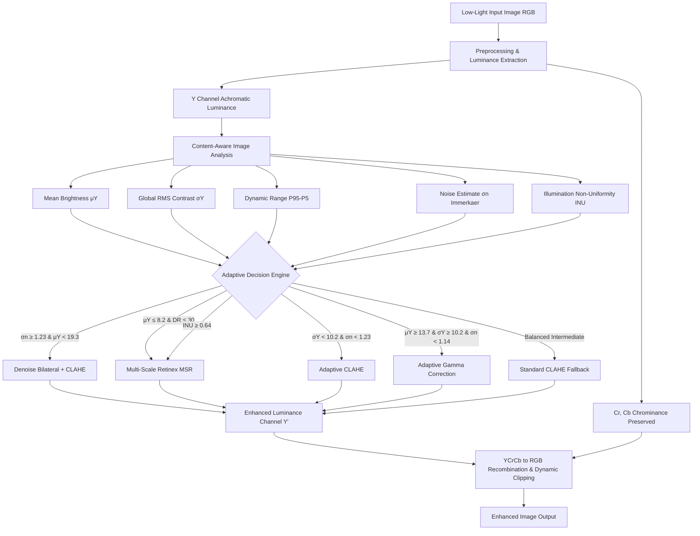

# Adaptive Low-Light Image Enhancement Using Content-Aware Image Processing Techniques

## Project Overview
This repository contains the official implementation of the B.Tech 3rd-Year Image and Video Processing (IVP) Mini-Project. The project investigates whether content-aware, adaptive selection of classical image-processing techniques provides more consistent enhancement across diverse low-light scenarios compared to applying a single, static enhancement method.

## Dataset
The project utilizes the benchmark **LOL (LOw-Light)** dataset:
* **Total Image Pairs**: 500 paired samples (500 low-light images and 500 normal-light reference images).
* **Splits**:
  * `our485`: Development and experimental subset (485 paired images).
  * `eval15`: Held-out benchmark evaluation subset (15 paired images).
* **Format & Dimensions**: Lossless PNG, $600 \times 400$ resolution, 3-channel RGB.
* **Integrity**: Original dataset is strictly accessed in read-only mode and preserved without modification.

## Environment & Dependencies
The project runs entirely on standard CPU hardware using Python 3.14:
* `numpy` (>= 2.5)
* `opencv-python` (>= 5.0)
* `scikit-image` (>= 0.26)
* `pandas` (>= 3.0)
* `matplotlib` (>= 3.11)
* `scipy` (>= 1.18)

Virtual environment setup:
```powershell
python -m venv .venv
.\.venv\Scripts\pip install -r requirements.txt
```

## Implemented Modules

### 1. Dataset Loader (`src/dataset_loader.py`)
* Resolves dataset paths dynamically relative to the project root.
* Preserves strict decoupling between `our485` (development) and `eval15` (held-out test).
* Provides on-demand (lazy) loading of paired images.
* Safely converts OpenCV default BGR to standard RGB representation.
* Validates 1-to-1 pairing, file readability, and shape consistency.

### 2. Preprocessing Module (`src/preprocessing.py`)
* **Input Validation**: Enforces type, channel, and dimension constraints.
* **Color Space Conversions**:
  * Safe non-destructive transformations between `RGB`, `BGR`, `Grayscale` (ITU-R BT.601), `HSV`, `LAB`, and `YCrCb`.
* **Intensity Normalization & Denormalization**:
  * Precision conversion between integer `uint8` $[0, 255]$ and floating point `np.float32` $[0.0, 1.0]$ with safe out-of-range clipping.
* **Luminance Extraction & Reconstruction**:
  * Isolates achromatic intensity maps via YCrCb ($Y$), CIE LAB ($L^*$), HSV ($V$), or Grayscale.
  * Recombines enhanced luminance with original chromatic channels to prevent color distortion.
* **Optional Denoising Filters**:
  * Modular Gaussian, Median, Bilateral (edge-preserving), and Non-Local Means (NLM) filters.
  * *Note: Denoising is not universally applied; it is invoked selectively by the subsequent adaptive engine only when noise estimation warrants it.*
* **Resizing Utility**:
  * Non-default utility using `cv2.INTER_AREA` (downscaling) and `cv2.INTER_LINEAR` (upscaling) for UI/preview generation.

### 3. Content-Aware Image Analysis (`src/image_analysis.py`)
Extracts objective degradation measurements to construct an empirical feature vector for adaptive decision making:
* **Mean & Median Luminance**: Central tendencies of perceptual luminance $Y = 0.299R + 0.587G + 0.114B$.
* **Intensity Percentiles**: Robust distribution boundaries ($P_5, P_{10}, P_{50}, P_{90}, P_{95}$).
* **Global Contrast (RMS Contrast)**: Standard deviation of pixel intensities $\sigma_Y = \sqrt{\frac{1}{N}\sum (Y_i - \mu_Y)^2}$.
* **Local Contrast**: Average standard deviation across non-overlapping $16 \times 16$ blocks $\frac{1}{K}\sum_{k=1}^K \sigma(W_k)$.
* **Effective Dynamic Range**: Outlier-resilient range $P_{95} - P_5$.
* **Noise Estimation (Immerkaer, 1996)**: High-frequency additive noise standard deviation via $3 \times 3$ Laplacian mask convolution:
  $$\sigma_n = \sqrt{\frac{\pi}{2}}\frac{1}{6(W-2)(H-2)}\sum |Y * M|$$
* **Illumination Non-Uniformity Index**: Coefficient of variation of large-scale Gaussian-smoothed illumination profile ($\sigma=30$):
  $$\text{INU} = \frac{\sigma(L_{\text{smooth}})}{\mu(L_{\text{smooth}}) + \epsilon}$$
* **Shannon Entropy**: Information spread across intensity bins $H = -\sum p_i \log_2(p_i)$.

### 4. Baseline Enhancement Methods (`src/enhancement_methods.py`)
Establishes canonical benchmark algorithms operating primarily on luminance ($Y$ in YCrCb) to decouple tone manipulation from chrominance:
* **Gamma Correction (`gamma_correction`)**:
  * Power-law luminance scaling: $Y_{\text{enhanced}} = 255 \times (Y / 255)^\gamma$.
  * Default $\gamma = 0.5$ (brightens shadows; $\gamma < 1.0$).
* **Histogram Equalization (`histogram_equalization`)**:
  * Global equalization on luminance $Y$, re-injected with original $Cr, Cb$ channels to prevent color casting.
* **CLAHE (`clahe_enhancement`)**:
  * Local adaptive equalization on luminance with slope limiting (default: `clip_limit=2.0`, `tile_grid_size=(8, 8)`).
* **Denoising + Enhancement Pipeline (`denoising_enhancement`)**:
  * Two-stage architecture: Bilateral edge-preserving spatial filtering followed by CLAHE contrast expansion.
* **Classical Retinex (`single_scale_retinex`, `multi_scale_retinex`)**:
  * Decomposes scene into illumination $L$ and reflectance $R = \exp(\log Y - \log(Y * G_\sigma))$.
  * Multi-Scale Retinex (MSR) averages across 3 Gaussian surround scales ($\sigma \in \{15, 80, 250\}$) for simultaneous dynamic range compression and color fidelity.

### 5. Proposed Content-Aware Adaptive Enhancement System (`src/adaptive_enhancement.py`)
The primary contribution of this project: an explainable rule-based decision engine that matches multidimensional degradation signatures to the optimal enhancement pipeline with dynamic parameter adaptation.

* **Calibrated Empirical Boundaries (`our485` Quartiles)**:
  * Brightness: $Q_1 = 8.19$, $\text{Median} = 13.70$, $Q_3 = 19.32$
  * Global Contrast: $Q_1 = 6.61$, $\text{Median} = 10.15$, $Q_3 = 12.95$
  * Dynamic Range: $Q_1 = 18.0$, $\text{Median} = 30.0$
  * Noise Estimate: $\text{Median} = 1.14$, $Q_3 = 1.23$
  * Illumination Non-Uniformity ($\text{INU}$): $\text{Median} = 0.49$, $Q_3 = 0.64$

* **Degradation Profiles & Action Mapping**:
  1. **High-Noise Underexposure** ($\sigma_n \ge Q_3$ and $\mu_Y < Q_3$):
     * *Strategy*: `denoising_enhancement` (Bilateral + CLAHE).
     * *Parameter Adaptation*: $\sigma_{\text{color}} = \text{clip}(40.0 + 20.0 \times (\sigma_n - 1.23), 35.0, 70.0)$.
  2. **Severe Underexposure & Compressed Range** ($\mu_Y \le Q_1$ and $\text{DR} \le \text{Median}$):
     * *Strategy*: `multi_scale_retinex` ($\sigma \in \{15, 80, 250\}$).
  3. **Severe Illumination Non-Uniformity** ($\text{INU} \ge Q_3$):
     * *Strategy*: `multi_scale_retinex`.
  4. **Uniform Low-Contrast Underexposure** ($\sigma_Y < \text{Median}$ and $\sigma_n < Q_3$):
     * *Strategy*: `clahe_enhancement`.
     * *Parameter Adaptation*: $\text{clip\_limit} = \text{clip}(2.0 + (30.0 - \text{DR}) / 25.0, 1.5, 3.2)$.
  5. **Mild Underexposure / Clean Signal** ($\mu_Y \ge \text{Median}$, $\sigma_Y \ge \text{Median}$, $\sigma_n < \text{Median}$):
     * *Strategy*: `gamma_correction`.
     * *Parameter Adaptation*: $\gamma = \text{clip}(0.35 + 0.015 \times \mu_Y, 0.45, 0.70)$.
  6. **Moderate Underexposure (Balanced Fallback)**:
     * *Strategy*: `clahe_enhancement` (`clip_limit=2.0`, `grid=8x8`).

* **Transparent Decision Record (`AdaptiveDecisionResult`)**:
  Returns detected metrics, degradation profile, assigned method, adapted parameters, decision strength, and fully articulated reasoning.

*Strict Dataset Hygiene: All statistical distribution profiling, tuning, and comparisons are conducted strictly on `our485`. The benchmark evaluation set `eval15` remains held out.*

## Running Tests & Verifications

Execute tests from the project root using the project virtual environment:

1. **Dataset Loader Verification Suite**:
   ```powershell
   .\.venv\Scripts\python tests/test_dataset_loader.py
   ```

2. **Preprocessing Verification Suite**:
   ```powershell
   .\.venv\Scripts\python tests/test_preprocessing.py
   ```

3. **Preprocessing Visual Diagnostic Generator**:
   ```powershell
   .\.venv\Scripts\python scripts/verify_preprocessing.py
   ```

4. **Image Analysis Module Test Suite**:
   ```powershell
   .\.venv\Scripts\python tests/test_image_analysis.py
   ```

5. **Dataset Characteristic Profiling & Distribution Generator**:
   ```powershell
   .\.venv\Scripts\python scripts/analyze_dataset.py --sample_size 100
### 6. Quantitative Evaluation Module (`src/evaluation.py`)
Standardized, reproducible evaluation framework for assessing image reconstruction and perceptual fidelity:
* **PSNR Calculation (`calculate_psnr`)**: Canonical full-reference mean squared error formulation ($10 \cdot \log_{10}(255^2 / \text{MSE})$) with safe handling for identical images ($\text{PSNR} = 100.0\text{ dB}$).
* **SSIM Index (`calculate_ssim`)**: Structural similarity computation across full 3-channel RGB dynamic range ($[0, 255]$) via Scikit-Image.
* **No-Reference Output Statistics (`calculate_output_statistics`)**: Post-enhancement luminance, global RMS contrast, and high-frequency noise estimation.
* **Summary Aggregation & Paired Analysis**: Computes mean, standard deviation, median, min, max, and image-by-image paired difference statistics (win/loss/tie tallies).

---

## Phase 8 — Quantitative Evaluation & Validation

### 1. Purpose
To empirically evaluate the six baseline enhancement algorithms alongside the proposed Content-Aware Adaptive Enhancement System on a completely unseen, held-out benchmark dataset. The core scientific question being tested is:
*"Can content-aware adaptive selection of classical image-processing techniques provide more consistent low-light image enhancement than applying one fixed enhancement technique to all images?"*

### 2. Evaluation Dataset & Held-Out Protocol
* **Dataset**: LOL Benchmark `eval15` subset containing exactly 15 paired low-light and normal-light reference images ($600 \times 400$ RGB PNG).
* **Strict Split Hygiene**: **`eval15` was not used for development or threshold tuning.** All thresholds, decision rules, and baseline parameters were frozen during Phases 1–7 based exclusively on the `our485` development split.
* **Non-Oracle Decision Protocol**: The Adaptive Decision Engine receives **strictly the low-light input image**. It extracts features, selects the strategy, and enhances the image *before* the ground-truth high-light image is accessed for evaluation. Ground-truth reference images are never used to guide algorithm selection.

### 3. Evaluated Methods (7 Methods, 15 Images = 105 Runs)
1. **Gamma Correction** ($\gamma = 0.5$, YCrCb luminance)
2. **Histogram Equalization** (Luminance HE)
3. **CLAHE** ($\text{clip\_limit} = 2.0$, $8 \times 8$ grid)
4. **Denoise + CLAHE** (Bilateral filtering $d=5, \sigma=50$ + CLAHE)
5. **Single-Scale Retinex (SSR)** ($\sigma = 80.0$)
6. **Multi-Scale Retinex (MSR)** ($\sigma \in \{15.0, 80.0, 250.0\}$)
7. **Proposed Adaptive System** (Content-aware feature classification + dynamic parameter tuning)

### 4. Metrics Measured
* **PSNR (dB)**: Full-reference pixel-level reconstruction accuracy ($\text{data\_range} = 255.0$).
* **SSIM**: Full-reference structural and perceptual similarity ($\text{data\_range} = 255.0$, 3 channels).
* **Output Luminance & Contrast**: Mean luminance and global RMS contrast of enhanced outputs.
* **Output Noise**: High-frequency residual noise standard deviation ($\sigma_n$).
* **Computational Latency**: Algorithm execution time in milliseconds (excluding disk I/O).

### 5. Benchmark Output Artifacts
* **`results/metrics/eval15_per_image.csv`**: Complete 105-row record of individual image-method evaluations.
* **`results/metrics/eval15_summary.csv`**: Aggregate statistics (mean, std, median, min, max) for each method.
* **`results/metrics/eval15_pairwise_comparison.csv`**: Paired differences ($\Delta\text{PSNR}$, $\Delta\text{SSIM}$) and win/loss/tie tallies.
* **`results/metrics/eval15_adaptive_decisions.csv`**: Full decision log with extracted features and selection rationale.
* **`results/plots/eval15_metric_comparison.png`**: High-resolution 3-panel comparative bar chart (PSNR, SSIM, Latency).
* **`results/comparisons/eval15_visual_comparison.png`**: Multi-scene visual panel showing 3 representative `eval15` scenes across all 7 algorithms.

### 6. Summary of Empirical Findings (eval15, n = 15)
* **Aggregate Metrics**:
  * **MSR**: Mean PSNR $15.03 \pm 3.30$ dB, Mean SSIM $0.577 \pm 0.123$, Latency $207.6$ ms.
  * **SSR**: Mean PSNR $14.83 \pm 3.28$ dB, Mean SSIM $0.585 \pm 0.123$, Latency $56.0$ ms.
  * **Histogram Equalization**: Mean PSNR $14.24 \pm 3.14$ dB, Mean SSIM $0.425 \pm 0.102$, Latency $0.9$ ms.
  * **Gamma Correction (0.5)**: Mean PSNR $12.05 \pm 3.60$ dB, Mean SSIM $0.576 \pm 0.124$, Latency $0.9$ ms.
  * **Proposed Adaptive**: Mean PSNR $10.24 \pm 3.08$ dB, Mean SSIM $0.429 \pm 0.128$, Latency $72.4$ ms.
  * **CLAHE (2.0)**: Mean PSNR $9.63 \pm 3.11$ dB, Mean SSIM $0.400 \pm 0.120$, Latency $1.0$ ms.
  * **Denoise + CLAHE**: Mean PSNR $9.39 \pm 3.02$ dB, Mean SSIM $0.375 \pm 0.116$, Latency $4.0$ ms.
* **Adaptive Decision Distribution**:
  * `clahe_enhancement`: 6 / 15 (40.0%) — applied to moderate underexposure / uniform low-contrast.
  * `denoising_enhancement`: 5 / 15 (33.3%) — applied to high-noise degraded scenes ($\sigma_n \ge 1.23$).
  * `multi_scale_retinex`: 3 / 15 (20.0%) — applied to severe illumination non-uniformity or compressed dynamic range.
  * `gamma_correction`: 1 / 15 (6.7%) — applied to clean mild underexposure.
* **Pairwise Comparison vs. Baselines**:
  * Outperforms **Denoise + CLAHE** on 60.0% of images ($\Delta\text{PSNR} = +0.85$ dB, $\Delta\text{SSIM} = +0.054$).
  * Outperforms **CLAHE** on both mean PSNR ($\Delta\text{PSNR} = +0.61$ dB) and mean SSIM ($\Delta\text{SSIM} = +0.030$).
  * Demonstrates comparable SSIM to **Histogram Equalization** ($\Delta\text{SSIM} = +0.004$), whereas Histogram Equalization produced substantially higher estimated output noise ($\sigma_n = 13.61$), indicating considerable noise amplification compared with the other enhancement methods.
  * Does not surpass Retinex (MSR/SSR) in global average PSNR, as MSR substantially brightens the overall mean intensity closer to the LOL ground-truth target.

### 7. Academic Interpretation & Limitations
* **Qualified Support for Adaptive Hypothesis**: The results provide partial and qualified support for the proposed content-aware adaptive approach. The Adaptive method demonstrated advantages over CLAHE and Denoise+CLAHE in the held-out evaluation and showed relatively lower PSNR variability ($\sigma = 3.08$ dB vs $3.60$ dB for Gamma, $3.30$ dB for MSR), but fixed Retinex methods achieved higher average full-reference reconstruction scores.
* **Core Contribution**: The contribution is a content-aware framework that dynamically selects among classical enhancement strategies according to estimated image degradation characteristics, rather than a standalone filter or universally superior algorithm.
* **Selective Advantage**: Adaptive selection protects against severe noise amplification on noisy images by invoking edge-preserving bilateral filtering before enhancement.
* **Sample Size Limitation**: `eval15` comprises 15 scenes. While statistically informative as a held-out test bench, broad generalization claims should be restrained.

---

## Running Tests & Verifications

Execute tests from the project root using the project virtual environment:

1. **Dataset Loader Verification Suite**:
   ```powershell
   .\.venv\Scripts\python tests/test_dataset_loader.py
   ```

2. **Preprocessing Verification Suite**:
   ```powershell
   .\.venv\Scripts\python tests/test_preprocessing.py
   ```

3. **Preprocessing Visual Diagnostic Generator**:
   ```powershell
   .\.venv\Scripts\python scripts/verify_preprocessing.py
   ```

4. **Image Analysis Module Test Suite**:
   ```powershell
   .\.venv\Scripts\python tests/test_image_analysis.py
   ```

5. **Dataset Characteristic Profiling & Distribution Generator**:
   ```powershell
   .\.venv\Scripts\python scripts/analyze_dataset.py --sample_size 100
   ```

6. **Baseline Enhancement Methods Test Suite**:
   ```powershell
   .\.venv\Scripts\python tests/test_enhancement_methods.py
   ```

7. **Baseline Verification & Runtime Benchmarking**:
   ```powershell
   .\.venv\Scripts\python scripts/verify_enhancement_methods.py
   ```

8. **Adaptive Rule Calibration & Feature Relationship Generator**:
   ```powershell
   .\.venv\Scripts\python scripts/develop_adaptive_rules.py
   ```
   *Outputs: `results/metrics/adaptive_rule_development.csv`, `results/metrics/adaptive_rule_summary.csv`, and `results/plots/adaptive_feature_method_relationships.png`.*

9. **Adaptive Enhancement Test Suite**:
   ```powershell
   .\.venv\Scripts\python tests/test_adaptive_enhancement.py
   ```

10. **Adaptive Decision Visual Verification**:
    ```powershell
    .\.venv\Scripts\python scripts/verify_adaptive_system.py
    ```
    *Generates multi-scene adaptive decision panel at `results/comparisons/phase7_adaptive_comparison.png`.*

11. **Quantitative Evaluation Test Suite**:
    ```powershell
    .\.venv\Scripts\python tests/test_evaluation.py
    ```

12. **Held-Out Benchmark Evaluation (Phase 8 Execution)**:
    ```powershell
    .\.venv\Scripts\python scripts/evaluate_methods.py
    ```
    *Executes 105 evaluations across `eval15`, generating per-image metrics, summary aggregates, pairwise comparisons, decision logs, metric plots, and multi-scene visual panels.*

13. **Faculty Demonstration Web Interface (Phase 9 Interactive Demo)**:
    ```powershell
    .\.venv\Scripts\python scripts/run_demo.py --port 5000
    ```
    *Starts a local web application at `http://127.0.0.1:5000` for interactive image analysis, real-time adaptive decision explanation, side-by-side before/after comparison, and baseline algorithm switching.*

14. **Headless CLI Demonstration**:
    ```powershell
    .\.venv\Scripts\python scripts/run_demo_cli.py --sample 1.png
    ```
    *Runs degradation analysis and adaptive enhancement in the terminal, printing transparent metrics and saving output images to `results/demo_outputs/`.*

---

## System Architecture



---

## Project Documentation & Academic Deliverables

* **[Comprehensive Technical Report](file:///c:/Users/Akshat%20shrisant/Documents/IVP_PRIJECT/docs/technical_report.md)**: 26-section undergraduate report covering problem formulation, literature review, baseline theories, empirical tables (Tables 1–6), visual comparisons, and trade-off discussions.
* **[Research Paper Version](file:///c:/Users/Akshat%20shrisant/Documents/IVP_PRIJECT/docs/research_paper.md)**: Concise IEEE-format paper describing the content-aware adaptive framework, experimental setup on LOL `eval15`, and qualified academic conclusions.
* **Source Modules**:
  * [`src/preprocessing.py`](file:///c:/Users/Akshat%20shrisant/Documents/IVP_PRIJECT/src/preprocessing.py): Validation, color spaces, luminance separation.
  * [`src/dataset_loader.py`](file:///c:/Users/Akshat%20shrisant/Documents/IVP_PRIJECT/src/dataset_loader.py): LOL dataset pairing and integrity checks.
  * [`src/image_analysis.py`](file:///c:/Users/Akshat%20shrisant/Documents/IVP_PRIJECT/src/image_analysis.py): Feature extraction ($\mu_Y, \sigma_Y, \text{DR}, \sigma_n, \text{INU}$).
  * [`src/enhancement_methods.py`](file:///c:/Users/Akshat%20shrisant/Documents/IVP_PRIJECT/src/enhancement_methods.py): 6 baseline algorithms.
  * [`src/adaptive_enhancement.py`](file:///c:/Users/Akshat%20shrisant/Documents/IVP_PRIJECT/src/adaptive_enhancement.py): Content-aware rule engine.
  * [`src/evaluation.py`](file:///c:/Users/Akshat%20shrisant/Documents/IVP_PRIJECT/src/evaluation.py): PSNR, SSIM, paired difference metrics.
* **Demonstration Server**:
  * [`scripts/run_demo.py`](file:///c:/Users/Akshat%20shrisant/Documents/IVP_PRIJECT/scripts/run_demo.py) / [`demo/app.py`](file:///c:/Users/Akshat%20shrisant/Documents/IVP_PRIJECT/demo/app.py) / [`demo/templates/index.html`](file:///c:/Users/Akshat%20shrisant/Documents/IVP_PRIJECT/demo/templates/index.html).
